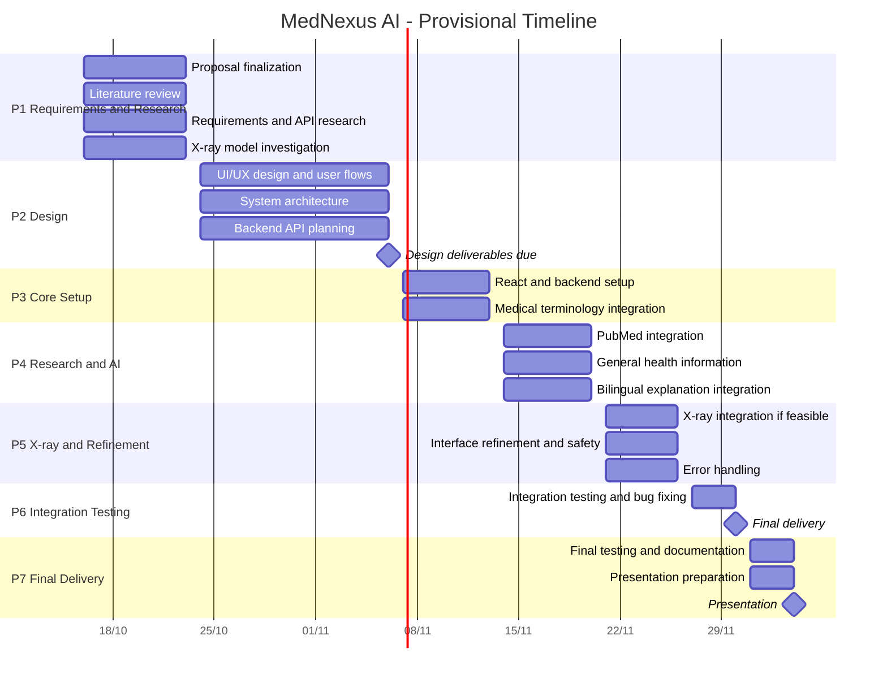

# Project Plan

> **Status:** The three final deadlines are **confirmed**. The period-by-period schedule is **provisional**: it may be adjusted to the supervisor's requirements and the team's actual progress. Blank fields have not been provided yet.

---

## 1. Planning Basis

| Item                           | Value                                                                                             | Status    |
| ------------------------------ | ------------------------------------------------------------------------------------------------- | --------- |
| Methodology                    | Iterative: requirements and API evaluation, then design, implementation, integration, and testing | Proposed  |
| Planning start date            | 16 October 2026                                                                                   | Proposed  |
| Final deadlines                | 6 Nov, 30 Nov, 4 Dec 2026                                                                         | Confirmed |
| Intermediate DEPI review dates |                                                                                                   |           |
| Weekly hours per member        |                                                                                                   |           |

---

## 2. Timeline (Provisional)

| Period | Dates | Activities | Expected deliverables |
|---|---|---|---|
| P1 | 16–23 Oct 2026 | Proposal finalization, literature review, requirements, API research, X-ray model investigation | Proposal, requirements specification, initial feasibility findings |
| P2 | 24 Oct – 6 Nov 2026 | UI/UX design, system architecture, user flows, backend API planning | UI designs, architecture diagram, API plan |
| P3 | 7–13 Nov 2026 | React project setup, backend setup, medical terminology integration | Initial working application and medical search |
| P4 | 14–20 Nov 2026 | PubMed integration, general health information retrieval, bilingual explanation integration | Research explorer and AI explanation workflow |
| P5 | 21–26 Nov 2026 | X-ray integration if feasible, interface refinement, error handling, safety controls | Experimental X-ray prototype if feasible; refined core application |
| P6 | 27–30 Nov 2026 | Integration testing, bug fixing, feature completion | Tested application and implementation report |
| P7 | 1–4 Dec 2026 | Final testing, documentation, presentation preparation, demonstration | Final report, presentation, project demonstration |

> The X-ray investigation starts early (P1) so that a problem with the model leaves time to decide on an alternative. If it needs more time, the core platform features are prioritized. Core features are built in parallel with the X-ray study and do not depend on it.

---

## 3. Gantt Chart (Provisional)

---

## 4. Milestones

| ID | Milestone | Date | Completion criteria | Status |
|---|---|---|---|---|
| M1 | End of requirements and research period (P1) | 23 Oct | Proposal, requirements specification, initial feasibility findings | Proposed |
| M2 | Analysis and design delivery | **6 Nov** | Software Architecture, Database Design, System Diagram, UI/UX Design submitted | Confirmed deadline |
| M3 | Initial working application | 13 Nov | Initial application with medical search | Proposed |
| M4 | Research explorer and AI explanation workflow | 20 Nov | PubMed search and explanation workflow working | Proposed |
| M5 | X-ray decision point and refined core application | 26 Nov | X-ray outcome decided (see [feasibility outcomes](new/Planning/06-assumptions-and-open-decisions.md#4-x-ray-feasibility-outcomes)); refined core application | Proposed |
| M6 | Final delivery | **30 Nov** | Source code on GitHub, README and documentation, application online or as suitable executables | Confirmed deadline |
| M7 | Presentation | **4 Dec** | Final report, presentation, and demonstration | Confirmed deadline |

---

## 5. Deliverables

| ID  | Deliverable                                                                  | Phase                          | Date                   | Status                                                                                                                                                                      |
| --- | ---------------------------------------------------------------------------- | ------------------------------ | ---------------------- | --------------------------------------------------------------------------------------------------------------------------------------------------------------------------- |
| D1  | Project proposal                                                             | Requirements Analysis          | 18 Oct                 |                                                                                                                                                                             |
| D2  | Requirements specification                                                   | Requirements Analysis          | 18 Oct                 |                                                                                                                                                                             |
| D3  | Initial project plan (this document)                                         | Requirements Analysis          | 18 Oct                 |                                                                                                                                                                             |
| D4  | API evaluation notes                                                         | Research and Feasibility       |                        |                                                                                                                                                                             |
| D5  | Initial source selection                                                     | Research and Feasibility       |                        |                                                                                                                                                                             |
| D6  | X-ray feasibility report                                                     | Research and Feasibility       |                        |                                                                                                                                                                             |
| D7  | System architecture diagram / Software Architecture                          | System Design                  | 6 Nov                  | Confirmed deadline                                                                                                                                                          |
| D8  | Database Design                                                              | System Design                  | 6 Nov                  | Confirmed deadline; content depends on the [database decision](new/Planning/06-assumptions-and-open-decisions.md#3-open-decisions) |
| D9  | System Diagram                                                               | System Design                  | 6 Nov                  | Confirmed deadline                                                                                                                                                          |
| D10 | UI/UX designs                                                                | System Design                  | 6 Nov                  | Confirmed deadline                                                                                                                                                          |
| D11 | API integration plan                                                         | System Design                  | By 6 Nov (provisional) |                                                                                                                                                                             |
| D12 | Working core application (medical search and research features)              | Core Implementation            |                        |                                                                                                                                                                             |
| D13 | X-ray analysis prototype, if feasible, with evaluation notes and limitations | Experimental X-ray Integration |                        |                                                                                                                                                                             |
| D14 | Test cases and results                                                       | Testing and Evaluation         |                        |                                                                                                                                                                             |
| D15 | Evaluation report                                                            | Testing and Evaluation         |                        |                                                                                                                                                                             |
| D16 | Source code on GitHub                                                        | Final Delivery                 | 30 Nov                 | Confirmed deadline                                                                                                                                                          |
| D17 | README and technical documentation                                           | Final Delivery                 | 30 Nov                 | Confirmed deadline                                                                                                                                                          |
| D18 | Running application (online link or suitable executables)                    | Final Delivery                 | 30 Nov                 | Confirmed deadline                                                                                                                                                          |
| D19 | Final report and presentation                                                | Final Delivery                 | 4 Dec                  | Confirmed deadline                                                                                                                                                          |

**Terminology:** a *milestone* is a point in time with a checkable outcome; a *task* is work done over a period; a *deliverable* is a concrete output handed in.

---

## 6. Resource Allocation

### 6.1 People

| Resource | Details | Status |
|---|---|---|
| Project team | Four members (placeholders); still learning front-end development, no practical backend experience yet | Confirmed |
| Weekly time per member | | |
| Project supervisor | Name not provided | |
| Course instructor | Available for technical questions; has indicated that backend topics will be taught, even if briefly | Confirmed |
| Reviewers | A party associated with DEPI (details not specified) | |

### 6.2 Technical Resources

| Resource                          | Purpose                                                                                | Status                                      |
| --------------------------------- | -------------------------------------------------------------------------------------- | ------------------------------------------- |
| GitHub                            | Source code and collaboration                                                          | Confirmed                                   |
| React.js, HTML5, CSS3, JavaScript | Frontend                                                                               | Proposed                                    |
| Node.js and Express.js            | Backend: external API requests, validation, error handling, protecting API credentials | Proposed                                    |
| NCBI MeSH                         | Terminology, scope notes, alternative terms                                            | Proposed; preliminary test done             |
| PubMed E-utilities                | Publication search, metadata, abstracts                                                | Proposed; preliminary test done             |
| MedlinePlus Web Services          | General health information (not a comprehensive terminology dictionary)                | Proposed; preliminary test done             |
| Gemini API                        | Simplified English and Arabic explanations                                             | Proposed; pricing and limits to be reviewed |
| X-ray model or inference service  | Experimental X-ray analysis                                                            | Under investigation; none selected          |
| Database                          | Bookmarks, saved searches, preferences                                                 | Optional; not decided                       |
| Hosting / deployment              |                                                                                        |                                             |
| Budget                            | Prefer free or open-source tools where possible                                        | Proposed                                    |

---

## 7. Scope and Change Control (Proposed)

1. New features are discussed in a team meeting and weighed against the remaining time before being added.
2. Decisions are recorded in [Assumptions and Open Decisions](new/Planning/06-assumptions-and-open-decisions.md).
3. If the experimental X-ray investigation needs more time, the core platform features are prioritized.

---
